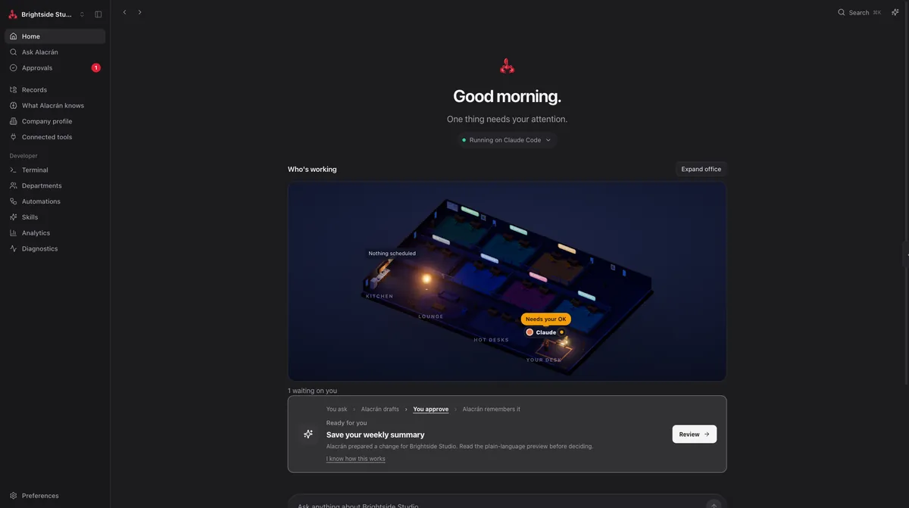
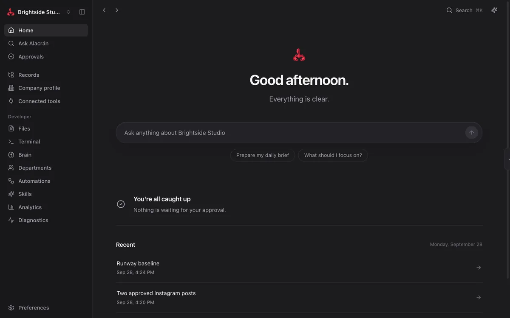
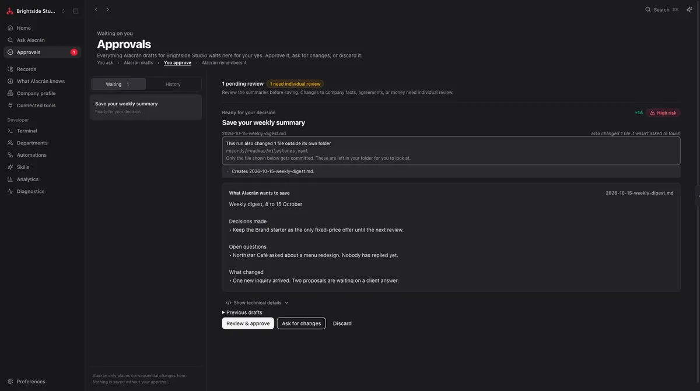
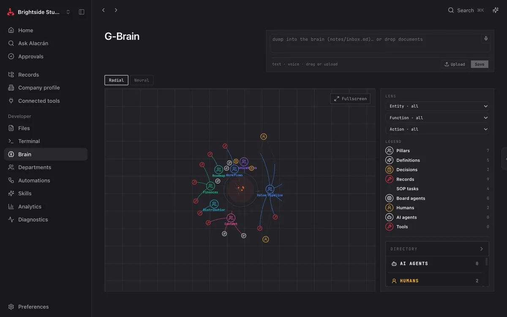
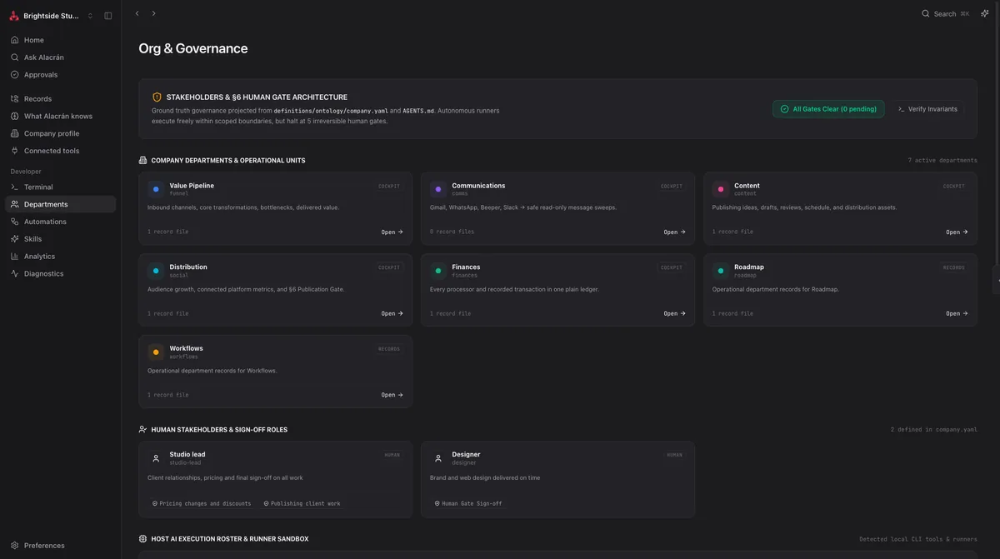
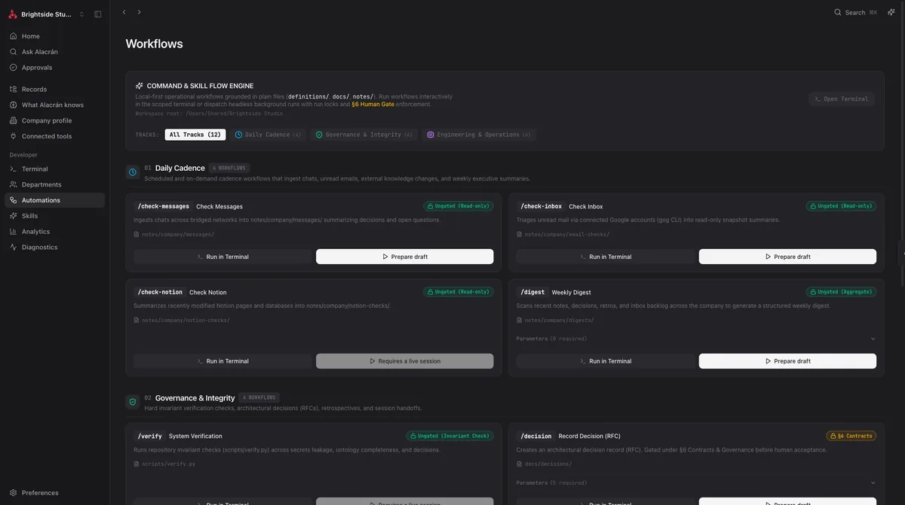
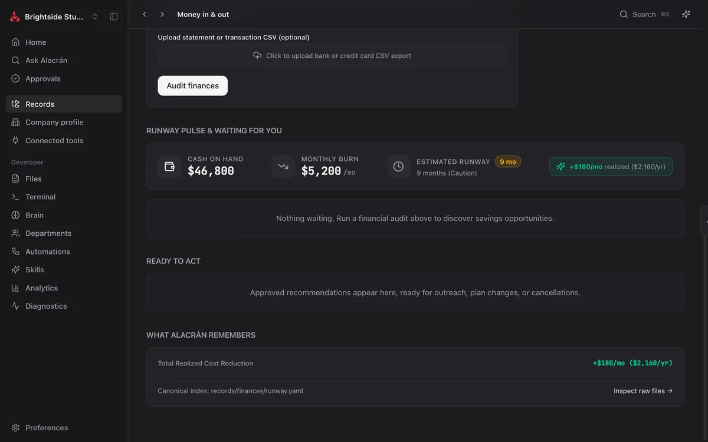
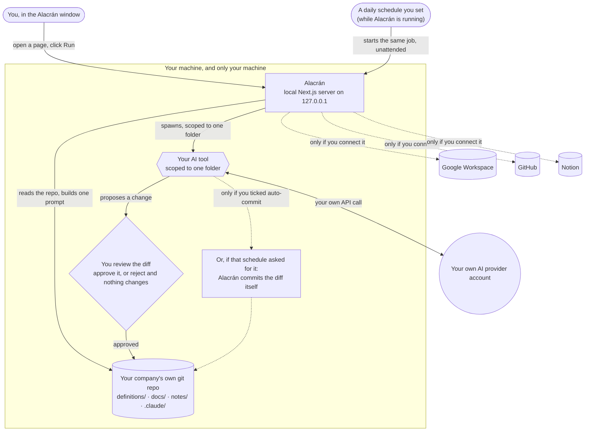

<div align="center">


# Alacrán

**Give your AI a memory of your business, on your own machine.**

Free and open source. No account, no cloud, no telemetry.

[](https://github.com/kwakuoseikwakye/alacran/actions/workflows/ci.yml)
[](https://github.com/kwakuoseikwakye/alacran-releases/releases/latest)
[](LICENSE)


[Install](#install-in-3-steps) | [Screenshots](#a-look-inside) | [Quick start](#quick-start) | [How it works](#how-it-works) | [Report a problem](CONTRIBUTING.md) | [Changelog](CHANGELOG.md)

<br />



<sub>Sample company, sample data.</sub>

</div>

---

## Install in 3 steps

**On a Mac** (about two minutes):

1. **Download the right file for your Mac.** Not sure which? Click the Apple menu, then **About This Mac**. If it says *Chip: Apple M1* (or M2, M3, M4), take Apple Silicon. If it says *Processor: Intel*, take Intel.

   | Your Mac | Download |
   |---|---|
   | Apple Silicon (M1 or newer) | [**Alacran-arm64.dmg**](https://github.com/kwakuoseikwakye/alacran-releases/releases/latest/download/Alacran-arm64.dmg) |
   | Intel | [**Alacran-x64.dmg**](https://github.com/kwakuoseikwakye/alacran-releases/releases/latest/download/Alacran-x64.dmg) |

2. **Open the `.dmg` and drag Alacrán into Applications.**
3. **Open Terminal, paste this once, press Return, then open Alacrán:**

   ```bash
   xattr -cr "/Applications/Alacran.app"
   ```

   Why: the app isn't notarized yet, so without this step macOS may say *"Alacrán is damaged and can't be opened."* It isn't damaged. This clears the flag your browser attached to the download. You only do it once. [More detail below](#install).

**On Debian or Ubuntu:**

```bash
curl -LO https://github.com/kwakuoseikwakye/alacran-releases/releases/latest/download/Alacran.deb
sudo apt install ./Alacran.deb
```

Then open **Alacrán** from your applications menu.

**First launch:** a short checklist makes sure you have Git and one AI tool (Claude Code is the default and installs from a button). Then you add your company and answer four questions. [Quick start](#quick-start) walks through it. Prefer to build it yourself? See [Development](#development).

## A look inside

Every screenshot is a made-up sample company, not real data.

<table>
  <tr>
    <td width="50%"><br /><sub><b>Home.</b> Ask anything about your company. When nothing is waiting, it says so.</sub></td>
    <td width="50%"><br /><sub><b>Approvals.</b> Every change the AI proposes waits for your yes, with a plain-language preview.</sub></td>
  </tr>
  <tr>
    <td width="50%"><br /><sub><b>Brain.</b> A map of what the AI knows: the company's facts, decisions, notes, past sessions and skills, and which of them it is unsure about.</sub></td>
    <td width="50%"><br /><sub><b>Departments.</b> Each department's records, and who signs off on what.</sub></td>
  </tr>
  <tr>
    <td width="50%"><br /><sub><b>Workflows.</b> Ready-made jobs, grouped by track. Prepare a draft, or run one in a terminal.</sub></td>
    <td width="50%"><br /><sub><b>Finances.</b> Cash on hand, monthly burn and runway, kept as plain records.</sub></td>
  </tr>
</table>

---

Every new AI chat starts as a total stranger. It doesn't know what your
business sells, who your customers are, or how you like things written, so
you end up retyping the same background paragraph before it can actually be
useful to you.

Alacrán fixes that. It's a small app that runs on your own computer. You
describe your business once, in plain language, and it writes that down as
real files in a folder **you** own. From then on, it hands those files to
your coding agent before every task, and shows you exactly what the agent
wants to change before anything gets saved.

There's no hosted service behind any of this. No account, no licence key, and
no server of ours your data could ever reach. It's a local Next.js server
that runs on `127.0.0.1`, wrapped in a native desktop window — no browser tab,
no address bar.

## What it actually does

- **Create a company.** One folder holding everything an AI should know
  about a business, scaffolded from one of 7 starter packs (General,
  Software engineering, Sales, Marketing, Customer support, HR & People,
  Leadership).
- **Guided setup.** A plain-language wizard asks about the business domain,
  the stakeholders, how value flows, and where the bottleneck is, then
  writes a structured ontology file for you. On the last step, click "Let
  Alacrán write it up" and your AI drafts it for you to read in Approvals, or
  "Save my answers as they are" to keep your own words with no AI at all.
- **A "Get Started" button for when you don't know where to start.** Your
  AI reads whatever skills and context you've actually built for this
  company and introduces itself: what it can do here, and what you might
  want to try first. It remembers what it already told you, too, so it
  only re-reads everything if something has genuinely changed since last
  time, not on every single click.
- **Run jobs.** Three you pick and run: `digest` (what happened this week,
  from your own notes), `decision` (write down an RFC) and `retro` (a KPT
  retrospective). Each spawns a headless agent scoped to a single output
  directory and shows you the diff before anything is committed. More commands
  sit beside them: `refresh` (keeps the ontology true),
  `check-messages` (writes down what your chats said in the last 24 hours),
  `check-inbox` (writes down the unread mail waiting in your connected Google
  account), `handoff` (updates HANDOFF.md for whoever opens the folder next),
  `session-note` (writes up a finished AI conversation), and `orientation` and
  `define-company`, which back Get Started and the setup wizard. The company
  template still ships `check-notion`, `triage-email` and `triage-issue` as
  real commands you can run in a terminal — they're just not one-click jobs in
  the app any more.
- **Keep your company info true.** `refresh` reads what's changed since the
  ontology was last written — the notes, decisions and retros you've added,
  plus your Notion if you've connected it — and proposes edits to only the
  lines the evidence actually contradicts, marking anything it isn't sure
  about with an inline `# unconfirmed:` note. Finding nothing to change is a
  normal outcome, and it says so rather than inventing an edit.
- **Let it run while you're not there.** Any job that doesn't need you to
  type something first — `digest`, `refresh`, `check-inbox`, `handoff`, `orientation` — can be set to
  run once a day at a time you pick. By default the result waits for you as a diff, with a dot on the
  sidebar so you know something's there. Tick **"commit the result for me,
  without asking"** on a schedule and that one runs end to end unattended,
  landing as a real commit you read afterwards instead of before. It's off
  unless you turn it on, one schedule at a time, and it's refused outright on
  any job that reads text written by people outside your company — today
  that's `refresh`, `check-messages` and `check-inbox`, which always wait for you. Turn on **Advanced mode** in Settings to see the control.
- **Edit and version skills.** Browse every skill and slash command across
  all your companies, edit them right in the app, and get real git history
  with per-commit diffs and one-click revert. Every write is its own
  single-file-scoped commit in that company's own repo.
- **Connect your tools.** Detect-and-guide setup for Claude Code, Google
  (Gmail and Calendar, more than one account if you need it), GitHub, and
  Notion. Alacrán never
  holds a credential of its own; it just checks whether *your* CLI or
  account is already signed in.
- **Connect MCP tools per company.** Point a company at Canva, Figma,
  Lovable, Docusign, Vercel or freee (accounting/HR) — no CLI to install, no
  key to paste. Alacrán writes the company's own `.mcp.json`; you approve
  and sign in once inside a real session, and the token stays in Claude
  Code's own store. These tools are available in **Open in Terminal** and
  **Get Started** sessions, deliberately *not* to the scoped jobs above,
  which keep their own fixed narrow permissions.
- **See the whole network at a glance.** A visual map of every company on
  your machine and exactly what it's plugged into (which AI runs it, and
  whether Google, GitHub, or Notion are actually connected), so it's
  obvious what's live and what isn't without opening every card.
- **Bring your own AI.** Claude Code, Kiro, Kimi Code, Codex CLI and Google
  Antigravity are registered, each on your own account and your own billing.
  Onboarding sets up Claude Code, which is the default, and each company can
  switch to another tool later. Whichever one runs a job, what it proposes
  still comes back to you as a diff before anything is saved.
- **Settings.** Switch between dark and light themes, check for updates
  on demand instead of waiting for the daily check, and reset a couple of
  one-time local hints if you want to see them again.

## Install

### Download a build

| Platform | File | |
|---|---|---|
| macOS (Apple Silicon / Intel) | Choose the matching `.dmg` | [Download](https://github.com/kwakuoseikwakye/alacran-releases/releases/latest) |
| Debian / Ubuntu | `Alacran.deb` | [Download](https://github.com/kwakuoseikwakye/alacran-releases/releases/latest/download/Alacran.deb) |

**macOS.** Open the `.dmg` and drag Alacrán to Applications. Then, before
the first launch, run this once in Terminal:

```bash
xattr -cr "/Applications/Alacran.app"
```

The build is ad-hoc signed but **not notarized**, since that requires a
paid Apple Developer account. Without the command above, macOS quarantines
the download and refuses to open it, often with the misleading message
*"Alacrán is damaged and can't be opened."* The app isn't damaged; it just
isn't signed by a registered developer. `xattr -cr` simply clears the
quarantine flag macOS attaches to anything downloaded from the internet.
Right-click then **Open** is not enough on its own for an ad-hoc-signed app
on current macOS.

You only need to do this **once**, for this first install from the download.
Later updates go through the app's own **Update & Restart** button, which
downloads the new build itself — and a file the app downloads is never
quarantined, so no `xattr` step is needed again.

*A signed and notarized pipeline would be a welcome contribution. It needs
a certificate, not code. See the [issue tracker](https://github.com/kwakuoseikwakye/alacran/issues) if you'd like to help.*

**Linux.**

```bash
sudo apt install ./Alacran.deb
# or: sudo dpkg -i Alacran.deb && sudo apt -f install
```

Then launch Alacrán from your applications menu.

Both builds bundle a standalone Next.js server. They start it locally and
show it in a native window — a real Cocoa window on macOS, a GTK/WebKit one on
Linux. Nothing opens in your browser except links that genuinely point at the
web, which are handed to your normal browser on purpose.

### Or build from source

See [Development](#development) below.

## Updating

Alacrán checks for a new release once a day and shows a banner when one's
available.

- **Linux**: click **Update & Restart** in the banner. It downloads the new
  `.deb`, installs it through a native `pkexec` password prompt (the same
  kind of prompt GNOME Software already uses), and restarts the app for
  you. If `pkexec` isn't installed, it shows you the exact
  `sudo apt install` command to run instead.
- **macOS**: click **Update & Restart** in the banner. It downloads the new
  build, swaps the installed app for it, and reopens it — no password
  prompt, and no `xattr -cr` needed. That last part surprises people, so:
  the quarantine flag that makes `xattr -cr` necessary is attached by your
  *browser*, not by the file's origin. An update the app downloads itself is
  never quarantined, so there's nothing to clear.

Set `ALACRAN_NO_UPDATE_CHECK=1` if you'd rather turn the check off entirely.

## Uninstalling

- **Linux**: `sudo apt remove alacran` keeps your data.
  `sudo apt purge alacran` also removes Alacrán's own registry and settings
  at `~/.local/share/Alacrán`. Either way, your companies' actual files
  (wherever you put them, by default in `~/Alacran/`) are left untouched.
- **macOS**: run `bash scripts/uninstall-macos.sh` from a checkout, or do it
  by hand: drag `/Applications/Alacran.app` to the Trash, and delete
  `~/Library/Application Support/Alacrán` too if you want its registry gone.
  (The app bundle is unaccented and the data folder accented — that really is
  the spelling of each, not a typo in one of them.)

## Prerequisites

Alacrán drives command-line tools that you install and authenticate
yourself. It never stores an API key, and it never proxies a request to a
model provider on your behalf.

**Required**

- **[Node.js](https://nodejs.org/).** The Mac app bundles its own, so there is
  nothing to install. On Linux the `.deb` pulls in `nodejs` (18 or newer)
  through `apt`. Building from source needs Node 20 or newer; check with
  `node -v`.
- **Git.** Every company is a git repository, and every write goes through
  a real commit. Check with `git --version`.
- **One AI tool.** Onboarding installs
  [Claude Code](https://docs.claude.com/en/docs/claude-code/overview) from a
  button (or `npm install -g @anthropic-ai/claude-code` if you prefer), and it
  needs a paid Claude plan to sign in with. Kiro, Kimi Code, Codex CLI and
  Google Antigravity work too if you already have one; pick it per company.

  You authenticate it yourself, with your own account. Alacrán just checks
  whether the binary exists and tells you plainly if it doesn't.

**Optional**

- **[`gog`](https://gogcli.sh)** (`brew install gogcli`), a Google API CLI.
  No app job calls it since v99, but it's what `check-inbox` and
  `triage-email` use when you run them yourself in a terminal. Alacrán detects
  it and walks you through installing it if it's missing.
- **[GitHub CLI](https://cli.github.com/) (`gh`)**, needed only for the
  optional "back up this company to a private repo" flow.

**Not required:** an Alacrán account, a licence key, or a network
connection for anything other than the AI calls themselves and a
once-a-day version check you can turn off.

## Quick start

1. **Open Alacrán.** A fresh install starts empty and walks you through a
   short onboarding screen with a dependency checklist.
2. **Add a company.** Type a path that doesn't exist yet and Alacrán offers
   to scaffold it from a starter pack. Type a path to an existing directory
   (with `.git` already in it) and it simply registers it.
3. **Answer four questions.** The setup wizard asks what the business does,
   who it serves, how value flows through it, and what's eating up your
   time, then writes `definitions/ontology/company.yaml` for you. Or click
   **Let Alacrán write it up** and your AI drafts it: you read it in
   **Approvals** and nothing is saved until you approve it.
4. **Not sure what's next? Click Get Started.** Your AI reads what's
   actually been set up for this company and tells you, in plain language,
   what it can help with.
5. **Run a job.** Open **Skills**, pick a command, and hit **Run**. The
   agent runs headlessly, scoped to a single output directory. When it's
   done, you get a diff, and nothing is written to git until you approve
   it.

A longer, step-by-step walkthrough (including what to do when macOS blocks
the first launch) lives in
[`landing/how-to-use/`](landing/how-to-use/index.html), which also happens
to be the source for the site's How-to-use page.

## How it works



Solid arrows are what happens on every single run, whether you started it or a
schedule did. Dotted arrows only happen if you turned that particular thing on
— a service you connected, or a schedule you told to commit for itself.
Nothing reaches Google, GitHub, or Notion unless you told it to, and nothing is
committed without you unless you asked for that too. The one exception is the
action log: when a live job sends an email, or you decide on a step a job
held for you, Alacrán appends one line to `records/actions/<YYYY-MM>.md` and
commits that one file, so the company's history says what went out. Walked through in words:

1. You click something in the app window. Alacrán, a plain local web server
   behind that window, handles the click. (Or nobody clicks anything: a schedule you set earlier
   comes due and starts the exact same job, through the exact same code.)
2. It reads whatever's relevant out of the company's own repo (its
   ontology, its skills, its notes) and turns that, plus what you typed,
   into a single prompt.
3. It spawns the company's AI tool (Claude Code unless you switched it) as a
   real subprocess, scoped to write inside one directory and nowhere else.
4. That subprocess makes its own API call to whichever provider you've
   authenticated (your account, your billing, never Alacrán's).
5. Whatever the agent proposes comes back to you as a diff, not a fait
   accompli. Approve it and it becomes a real git commit. Reject it and
   nothing on disk ever changes. If you weren't at the machine — because it
   ran at 07:00 and you got up at 09:00 — the diff simply waits, and the
   sidebar carries a dot until you've dealt with it. The one exception is a
   schedule you explicitly told to commit for itself: Alacrán still computes
   the diff and still makes the commit, it just doesn't wait for you to read
   it first.

A few design decisions worth knowing, because they constrain everything
else:

- **Your data is plain files in your own git repos.** Alacrán stores only
  its own registry (`~/Library/Application Support/Alacrán` on macOS,
  `$XDG_DATA_HOME` on Linux). Delete the app and every company you made is
  still sitting there, readable without it.
- **Every write is a single-file-scoped commit.** `git add -- <file> && git
  commit -- <file>`, never a bare `git commit` that could sweep up
  unrelated changes in your repo.
- **Two independent gates on every write path:** containment
  (`lib/path-guard.ts`, the resolved real path has to be inside a known
  company's root) and membership (`lib/resolve-known-skill.ts`, it has to
  correspond to an actual known skill file). Both, always, on every read
  and every write.
- **Spawned agents are scoped, not trusted.** Each command's session gets
  `--allowedTools Read,Grep,Glob,Edit(<one directory>)`, plus
  narrowly-pattern-matched `Bash(...)` access only where a command
  genuinely needs a CLI. Blanket `Write` and `--permission-mode
  acceptEdits` are deliberately never used; see
  [v8 in the changelog](CHANGELOG.md) for the live test that proved why.
- **The app detects what changed; the agent never commits.** Alacrán diffs
  the result itself and shows it to you. Approval is a human step by
  construction, not a setting you could accidentally turn off.
- **A scheduled run is the same run, minus the click** — with one exception:
  if you set a monthly limit and this month's estimated cost has reached it,
  Alacrán won't start it. Same prompt, same tool allowlist, same per-company
  lock, same diff.
- **Auto-commit is opt-in, per schedule, and never the default.** Even with
  it on, the agent still doesn't commit: Alacrán diffs the result itself and
  makes the same single-file-scoped commit it would make if you'd clicked
  approve, through the same containment checks. The only thing that changes
  is whether a person read the diff first. It cannot be turned on at all for
  a job whose prompt carries text written by someone outside the company —
  that's the one case where "nobody looked at it" is the entire risk, so it's
  refused in code rather than left to a checkbox.

For the reasoning behind each of these, [`CHANGELOG.md`](CHANGELOG.md) has
a detailed, dated writeup of every feature that shipped, including the
ones that were investigated and deliberately never built, plus the
security bugs found during live testing. [`AGENTS.md`](AGENTS.md) carries the
standing conventions for contributors and AI coding agents.

## Development

```bash
git clone https://github.com/kwakuoseikwakye/alacran.git
cd alacran
npm install
npm run dev          # http://localhost:3000
```

| Command | What it does |
|---|---|
| `npm run dev` | Dev server with Fast Refresh |
| `npm test` | Full vitest suite (no network, no real subprocesses) |
| `npm run lint` | ESLint |
| `npx tsc --noEmit` | Type check |
| `npm run build` | Production build |
| `bash scripts/package-linux.sh` | Build `Alacran.deb` (Debian/Ubuntu) |

The macOS desktop shell (an Electron wrapper around this same app) is built
and released separately; its source is not part of this repository. The
prebuilt `.dmg` files are on the
[releases page](https://github.com/kwakuoseikwakye/alacran-releases/releases/latest).

**Tech:** Next.js 15 (App Router), React 19, TypeScript, Tailwind v4,
Radix primitives, vitest.

**Testing philosophy.** Every function that shells out or touches the
filesystem takes an injectable `ExecFn`/`SpawnFn` with a real default, so
the suite never spawns a real process, never hits the network, and never
reads the real clock. If you add a new one, follow the same pattern:
a test that needs the real world is a test that will be flaky for
everyone else, sooner or later.

**Layout:**

```
app/          Next.js routes (/, /network, /activity, /skills, /connect)
components/   React components; components/ui/* are shadcn-style primitives
lib/          All logic. *-impl.ts holds the injectable seam, the sibling
              file is the thin "use server" Server Action wrapper.
templates/    The company starter template + 7 starter packs (plain files)
scripts/      Packaging and asset-generation scripts
landing/      The static marketing site (plain HTML/CSS, no build step)
docs/         Design specs and implementation plans, one per slice
```

See [CONTRIBUTING.md](CONTRIBUTING.md) before opening a PR, particularly
the conventions around `components/ui/*` (don't edit them directly) and
design tokens.

## Privacy

There is no analytics, no telemetry, and no crash reporting anywhere in
this app. Not disabled by default; simply not present. Here's the complete
list of what actually leaves your machine:

1. **Your prompts**, to whichever AI a company is pointed at, whenever you
   press Run. That's just the agent CLI doing its job.
2. **A version number check** against the public releases page, at most
   once a day, so the app can tell you when an update exists. An anonymous
   read of a public URL, and you can dismiss or disable it.
3. **Your files to your own private GitHub repo**, only if you press
   Back up.
4. **Your voice**, but only while you are actually speaking to the
   Assistant — never in the background, and never unless you press the
   orb, hold space, or have turned on **Wake with a double clap** (off by
   default, and only available once the microphone is on). With that
   switch on, after you stop the microphone the Assistant keeps it open
   while its window is visible, and only measures how loud the room is to
   hear two claps: nothing is recorded or sent anywhere until you clap,
   and your computer's own microphone light stays on the whole time.
   Where it goes depends on which engine you pick in
   **Settings › Voice**, and the page tells you before you choose:
   - **This computer's browser engine** (the default). Despite the name,
     this is *not* on-device: Chromium's speech API streams your
     microphone to **Google's** speech service. It needs no account,
     which is why it is the default — but it is a third party you didn't
     pick, and that is why it is written down here.
   - **Deepgram, with your own account.** Your voice goes to Deepgram,
     billed to you. Your API key never leaves this computer — the app
     swaps it for a short-lived pass each time you speak, and the audio
     goes from your window straight to Deepgram without passing through
     Alacrán.
   - **ElevenLabs agent, with your own account.** Your voice and the
     conversation go to ElevenLabs and to the AI model you let their agent
     use. When you ask about your company, the answer from your own AI on
     this computer is sent to ElevenLabs so it can be spoken. Your key goes
     only to ElevenLabs, sent from this computer's own server to set up your
     agent and start each call — it is never put in the app window. The
     window only receives a call link made for each call. The agent
     lives in your ElevenLabs account and keeps the assistant's name, your
     name, the languages you chose and the assistant's behaviour
     instructions there; your first name is spoken in its greeting. ElevenLabs
     bills your own account by the minute. A call ends by itself after 2
     minutes of silence or at the longest call length you set (10 minutes
     unless you change it), and closing the assistant panel ends it too.

   Unless you choose the ElevenLabs agent, spoken replies are made by your
   own computer's built-in voice and go nowhere. Typing your question
   instead sends no audio at all.

That's the whole list.

**The names you give the assistant.** The first time you open the Assistant
page it asks four things — what to call it, what it should call you, the
language you'll speak, and the language it should answer in. They are stored
in one owner-only file in your own data directory, alongside the voice
setting, and are editable afterwards under **Settings › Assistant**. They are
not a separate thing that leaves your machine: they ride along inside item 1,
because your name is part of the prompt the assistant is answering with. Leave
either name blank if you'd rather it didn't have one. The source is right here, so verify it yourself
rather than taking our word for it.

## Status and honest caveats

Alacrán is genuinely used every day by its author, but it's still a young
project maintained by one person. Here are the rough edges, stated
plainly:

- **macOS builds aren't notarized.** You need to run `xattr -cr` on the
  installed app before the first launch. Only that first one — in-app
  updates aren't affected. See [Install](#install).
- **Windows isn't built.** Only macOS and Debian/Ubuntu for now.
- **Auto-commit means what it says.** A schedule with it ticked writes to
  your repo with nobody watching. Every write is still confined to that
  command's own output folder and still lands as its own single-file commit,
  so `git log` and `git revert` are the undo — but if you want a human read
  before anything is written, leave it off, which is how it ships.
- **Scheduled runs need Alacrán to be running.** The timer lives in the
  app's own local server, and that server's lifetime is now the window's:
  closing the window quits Alacrán and stops the schedule, the same as any
  other desktop app. (Before the native window this was the one thing you
  could close and keep running — a closed browser tab left the server up.
  Minimise the window instead if you want a schedule to keep firing.) A run that was missed fires when the app next
  starts, rather than being skipped for the day. Once a day at a set time is
  all it does; there's no cron expression and no sub-daily interval.
- **MCP tools are remote-only.** Only remote (`https://`) servers can be
  added from the app — a local, command-launched server is still
  `claude mcp add` in a terminal.
- **`refresh` proposes; it can't verify.** It reads your repo (and Notion, if
  connected) and edits only what it found evidence for, marking anything
  uncertain inline. It cannot check any of that against reality — the diff is
  there because a human still has to.
- **No support SLA.** Reports are read and genuinely welcome, but this is a
  one-person project. If you need it to work a particular way on a particular
  timeline, there is no way to buy that, but the source is MIT-licensed, so you
  are free to change it yourself.

## Reporting a problem

Bug reports and feature requests are welcome. Start with
[CONTRIBUTING.md](CONTRIBUTING.md); security issues should go to
[SECURITY.md](SECURITY.md) instead.

## Source and licence

Alacrán is open source under the [MIT licence](LICENSE). The source lives at
[github.com/kwakuoseikwakye/alacran](https://github.com/kwakuoseikwakye/alacran),
and prebuilt downloads are published at
[github.com/kwakuoseikwakye/alacran-releases](https://github.com/kwakuoseikwakye/alacran-releases/releases/latest).
Contributions are welcome; start with [CONTRIBUTING.md](CONTRIBUTING.md).

The scaffolding Alacrán copies into each company you create is licensed
separately under MIT — see `templates/company-starter/LICENSE.md`. That is
content you receive and own, not this app's source.

Brand icons are official [Simple Icons](https://simpleicons.org/) (CC0),
extracted by `scripts/generate-brand-icons.mjs`. Never hand-drawn.
Bundled fonts, 3D models and vendored skill packs, with their licences, are
listed in [THIRD_PARTY_NOTICES.md](THIRD_PARTY_NOTICES.md).

## Trademarks

Claude, Anthropic, Notion, Beeper, Kiro, Kimi, Codex, OpenAI, Google,
Antigravity, GitHub, Slack, Telegram, Canva, Figma and every other third-party
name, product or logo mentioned in this repository or in the app belong to
their respective owners. They are used only to say which tools Alacrán can
work with. Alacrán is an independent project and is not affiliated with,
endorsed by or sponsored by any of them.
